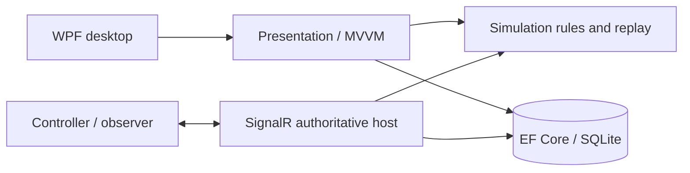

<p align="center">
  
</p>

<p align="center">
  <a href="https://github.com/DevMursLab/aegis-sim-desktop/actions/workflows/build.yml"></a>
  
  
  
  
</p>

# AEGIS-SIM Desktop

A Windows desktop logistics simulator built with **C#/.NET, WPF/MVVM, EF Core, SQLite and SignalR**. Run a synthetic supply-delivery exercise, close a road, inspect dispatch decisions, and reconstruct the saved run through verified replay.

**Desktop 3.3.1 / simulation engine 3.2.0.** This patch reorganizes documentation and packaging; simulation rules and saved-history formats are unchanged from desktop 3.3.0.

[Windows download](https://github.com/DevMursLab/aegis-sim-desktop/releases/tag/v3.3.1) &middot; [Quick review](docs/REVIEWER-GUIDE.md) &middot; [User guide](docs/user-guide.md) &middot; [Architecture](docs/architecture.md) &middot; [Verification](docs/verification.md)


## Features

| Area | Implemented behavior |
|---|---|
| Simulation | Start/pause/step/reset, finite inventory, cargo reservations, restock, 1-8 vehicles and static shelter priorities |
| Routing | Offline road-derived scenarios, deterministic Dijkstra paths, shared road closures and explicit junction rerouting |
| Desktop | Map selection and pan/zoom, validated scenario editor, bounded JSON/XML import/export and offline GeoJSON inspection |
| Persistence | Transactional SQLite history, typed events, checksummed checkpoints, compatible legacy histories and read-only replay |
| Analysis | Compatible-run A/B comparison, exact completion preview, diagnostics and verified PDF/HTML/CSV reports |
| Networking | Local authoritative host, controller/observer roles, version checks, deduplication and restart/reconnect recovery |
| Optional experiment | Synthetic-data forecast lab with separate training/holdout groups and exported evaluation |

## Application gallery

These are captures of the actual Windows application. Click an image to inspect it at full size.

<table>
<tr><td width="50%"><strong>Junction routing</strong><br><a href="docs/images/junction-routing.png"></a></td><td width="50%"><strong>Shared-stock fleet</strong><br><a href="docs/images/fleet-transit.png"></a></td></tr>
<tr><td><strong>Scenario editor</strong><br><a href="docs/images/scenario-editor.png"></a></td><td><strong>Priority dispatch</strong><br><a href="docs/images/priority-demo.png"></a></td></tr>
</table>

## Run

**Packaged application:** download the Windows x64 ZIP, verify its SHA-256, extract it and run `Start-Seeded-Demo.cmd` or `Start-Local.cmd`. The runtime is included; no SDK, cloud account or external map tiles are required. Optional `Install.ps1` installs for the current user.

**From source:** Windows x64 and the .NET 10 SDK are required.

```powershell
dotnet run --project src/Aegis.Desktop.Wpf
```

Create an isolated pair of review histories:

```powershell
dotnet run --project src/Aegis.Tools -- --seed .\artifacts\review-demo
dotnet run --project src/Aegis.Desktop.Wpf -- --data-dir .\artifacts\review-demo
```

Local history defaults to `%LOCALAPPDATA%\AEGIS-SIM\local\runs.db`. Saved runs open as read-only replay; **Reset** creates a fresh run and preserves previous history.

## Reproducible exercises

| Exercise | Expected synthetic result |
|---|---|
| Seeded baseline / shelter closure | 6 / 8 logical ticks; 48 packets delivered in both |
| Three-vehicle fleet | 48 packets delivered and all vehicles returned at tick 8 |
| Default road-network demo | 30 packets delivered and all vehicles returned at tick 14 |
| Finite-stock demo | Shortage at tick 16; Restock +20 permits completion at tick 24 |

For road incidents, junction diversion, replay and two-client setup, follow the [user guide](docs/user-guide.md) and [demo walkthrough](docs/demo-script.md). These observations describe the supplied synthetic models, not field performance.

## Design



Simulation and presentation are independent of WPF. A candidate command is replayed and validated, committed to storage, then published to the screen or clients. [Architecture and tradeoffs](docs/architecture.md).

## Verify and package

```powershell
powershell -ExecutionPolicy Bypass -File .\scripts\verify.ps1
powershell -ExecutionPolicy Bypass -File .\scripts\package.ps1 -OutputDirectory .\artifacts\AEGIS-SIM-3.3.1-win-x64
python .\scripts\verify-package.py .\artifacts\AEGIS-SIM-3.3.1-win-x64.zip
```

The documented source audit passed **212 executable console checks**, three reference console samples, a Release build with zero warnings/errors, and actual WPF/reconnect flows with no binding errors. Checks are console executables rather than an xUnit suite. Use `-SkipUi` for console-only CI. See [verification evidence and limits](docs/verification.md).

Packages include a source/version manifest and SHA-256 sidecar. Package checks use isolated extraction and data directories to test startup, seeded replay, tools, installation and host health.

## Scope

Independent portfolio software using fictional civilian data; it does not reproduce an institution's internal system. Networking is loopback-only. GeoJSON support is bounded and regional; movement uses logical ticks without traffic or collision modeling. The forecast lab is a generated-data learning experiment, not a field-validated predictor. General GIS, cloud hosting, high-load acceptance, signed installation and broad accessibility/DPI audits remain future work. [Project status](docs/PROJECT-STATUS.md) &middot; [Release notes](docs/release-notes.md) &middot; [Third-party notices](THIRD-PARTY-NOTICES.md).
