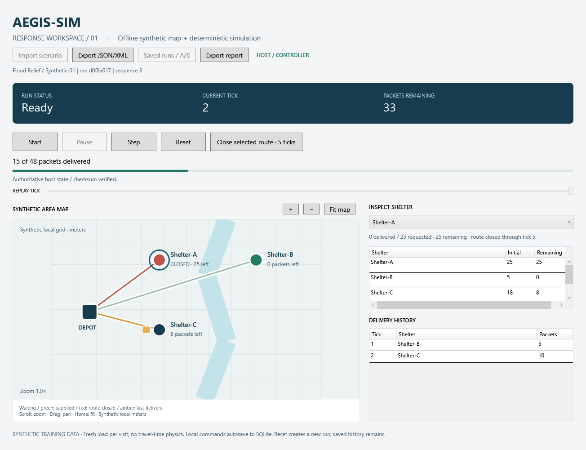
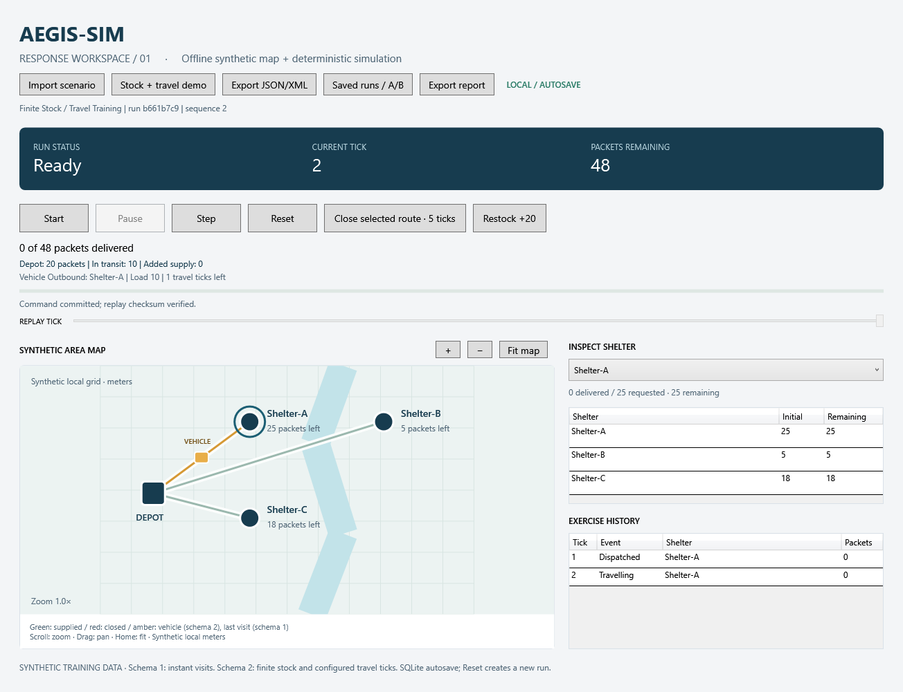
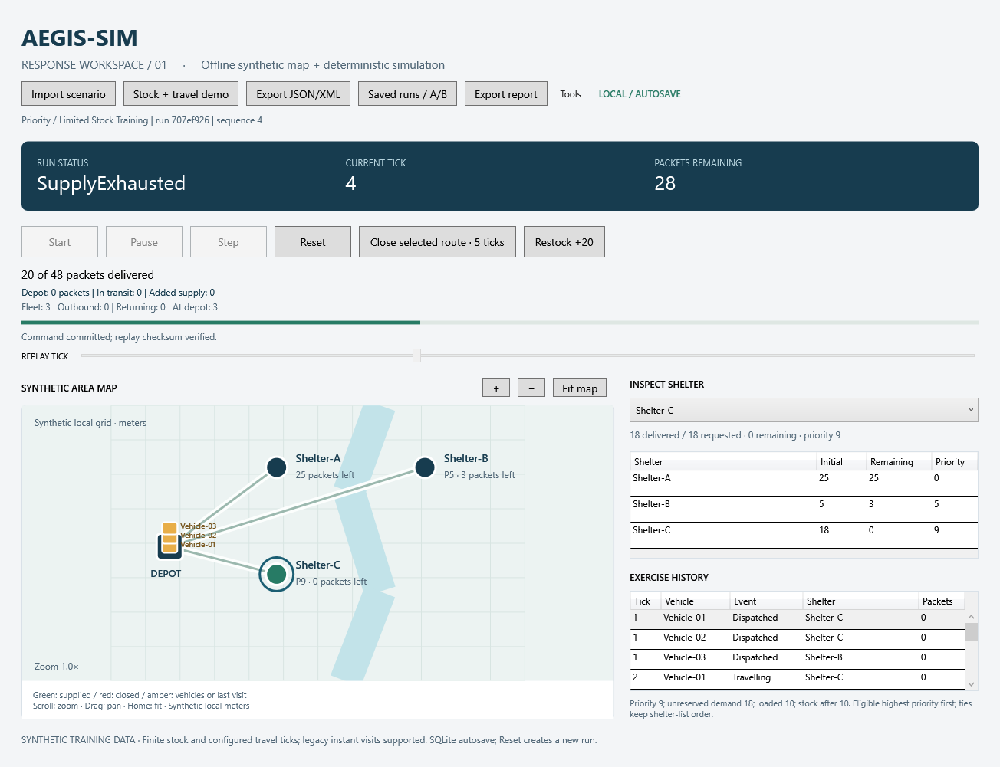
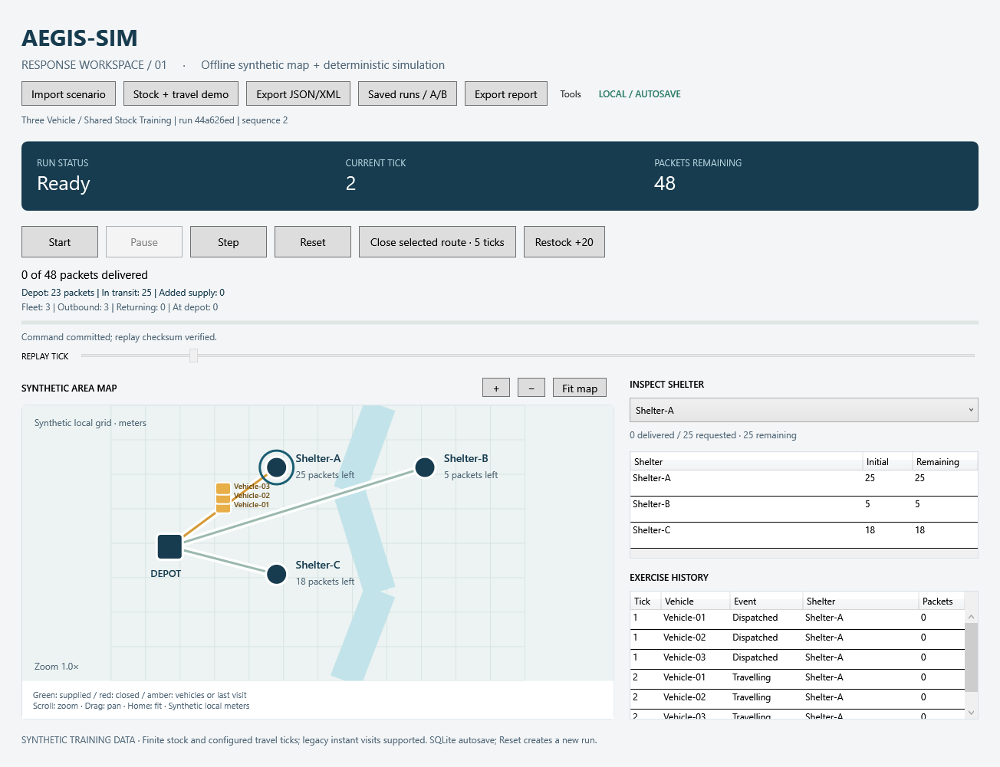
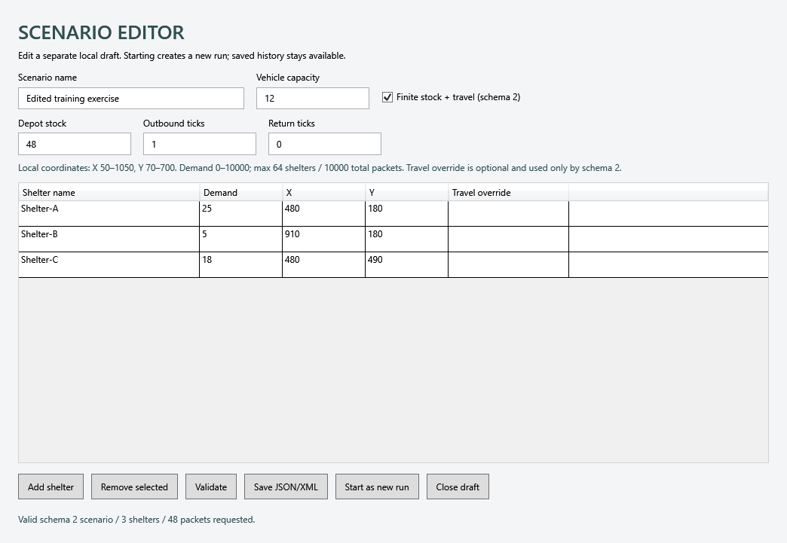
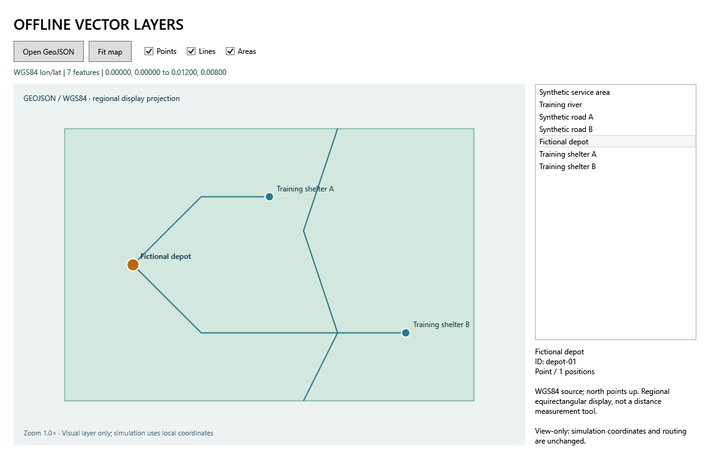

# AEGIS-SIM Desktop / 2.5 source

A **synthetic civilian response-training simulator** built with C#, .NET 10, WPF/MVVM, EF Core/SQLite and SignalR. Run an exercise, inject a route closure, persist commands/events, reconstruct history and compare measured outcomes.



## A reviewable three-minute demo

1. Open the desktop app and select Shelter-A.
2. Close its route for five logical ticks and start the run.
3. Watch the map, inspector, event table and metrics change together.
4. Reopen a saved run after closing the app; seek its read-only replay timeline.
5. Compare baseline and incident runs, then export verified PDF/HTML/CSV.
6. Start a controller and observer; interrupt/restart the host and watch automatic state recovery.

The supplied seed tool produces the same comparison every time: **baseline 6 ticks / closure run 8 ticks / 48 packets delivered in both**. These are synthetic-model observations, not real-world performance claims. [Detailed demo script](docs/demo-script.md).

## Implemented

| Area | Working behavior |
|---|---|
| Desktop | Start, Pause, Resume, Step, Reset; command enablement and error feedback |
| Map | Offline local-meter vector view, selection, inspector, pan/zoom, keyboard alternatives |
| Offline GIS viewer | Bounded WGS84 GeoJSON import, Point/LineString/simple Polygon, feature selection, layer toggles and pan/zoom; view-only |
| Planning | Background deterministic completion preview, shortage explanation and cancellation; no history mutation |
| Diagnostics | Verified run/runtime snapshot export without credentials or paths; reproducible engine/replay profiling |
| Scenarios | Bounded/versioned JSON and XML import/export; coordinates, unique names and quantities validated; XML DTD/external resolver disabled |
| Logistics | Finite depot stock, cargo reservation, outbound/return ticks, shortage and replayable restock; vehicle position follows state |
| Incidents | Selected shelter route closed for five ticks; availability, ordering and completion metrics change |
| Persistence | Transactional EF Core SQLite runs, unique commands, typed tick events and checksummed checkpoints |
| Replay | Durable command replay, state-hash validation, read-only timeline; original history remains immutable |
| Comparison | Compatible-run A/B ticks, deliveries, mean service tick, active-tick percentage and waiting ticks |
| Reports | Actual PDF, UTF-8 HTML and CSV generated from verified replay; HTML/CSV escaping |
| Multiplayer | Local authoritative host, separate controller/observer tokens, version checks, deduplication, full-snapshot resync and automatic reconnect |
| Packaging | Self-contained Windows x64 ZIP, seeded demonstrations, per-user installer and source verification scripts |
| Learning | Bangla lessons from variables through persistence, replay, networking and packaging |

## Run from source

Requirements: **Windows x64 and the .NET 10 SDK**. Dependencies restore from NuGet; pinned versions and lock files are committed. No paid API, cloud account, external map tiles or manually configured database is required.

```powershell
powershell -ExecutionPolicy Bypass -File .\scripts\run-lesson.ps1 -Lesson 05
```

Or `dotnet run --project src/Aegis.Desktop.Wpf`. On first launch a local run is created. Later launches open the most recent saved run as read-only replay; **Reset** starts a fresh run with a new ID.

Local data: `%LOCALAPPDATA%\AEGIS-SIM\local\runs.db`. Import sample files from `assets/scenarios/`. Select **Saved runs / A/B** to replay one run or Ctrl+select two compatible runs to compare. Export report saves the **full selected run**, even when the replay slider is at an earlier tick.

Seed a separate review folder:

```powershell
dotnet run --project src/Aegis.Tools -- --seed .\artifacts\review-demo
dotnet run --project src/Aegis.Desktop.Wpf -- --data-dir .\artifacts\review-demo
```

The lesson launcher also supports a user-local SDK at `%LOCALAPPDATA%\Microsoft\dotnet`.

## Stock and travel exercise

Select **Stock + travel demo** in the source-built desktop, or import `assets/scenarios/finite-stock-travel.json`. Dispatch reserves cargo; arrival delivers it; the vehicle returns before loading again. The sample starts with 30 packets, stops at tick 16 with 18 still needed, then **Restock +20** permits completion at tick 24 with 2 in stock. Closure pauses an outbound vehicle; return travel is unaffected. [Bangla lesson 10](docs/learning/10-stock-travel.bn.md).

Desktop/engine 2.5 reads original 2.0, 2.1 and 2.4 histories without changing their old hashes. Older binaries cannot open new engine 2.5 histories. [Release notes and remaining work](docs/release-notes.md).



[Shortage screen at tick 16](docs/images/logistics-shortage.png).

## Priority dispatch (2.5 source)

Select **Tools / Priority + limited stock demo** or import `assets/scenarios/priority-limited-stock.json`. Priority 0-9 applies to fleet scenarios only. Higher ranks go first among open routes with unreserved demand; ties keep source-list order. With 20 packets, C (rank 9) receives 18 and B (rank 5) receives 2; A (rank 0) waits. All vehicles return at tick 4 before supply exhaustion. Select a dispatch row for its decision trace. The editor exposes ranks; replay and per-vehicle CSV preserve reasons. [Bangla lesson 15](docs/learning/15-priority-dispatch.bn.md). Priority is static, not a live command or starvation-prevention guarantee.



## Fleet simulation

Select **Tools / Three-vehicle demo**, or import `assets/scenarios/three-vehicle-fleet.json`. Three capacity-10 vehicles share 48 packets and complete at tick 8 with outbound=2 and return=1. The matching one-vehicle model needs 24 ticks. All vehicles use stable IDs, cargo reservations prevent double allocation, and completion waits for every return. The editor accepts 1-8 vehicles. [Bangla lesson 14](docs/learning/14-multiple-vehicles.bn.md).

Fleet actions persist inside one aggregate event per tick, preserving the SQL event key. The map and event table show each vehicle. PDF/HTML use replayed metrics; fleet export adds a per-vehicle CSV. Outbound/return counts are vehicle-ticks, while active percentage still counts elapsed ticks with any delivery. Static priority dispatch is supported: highest eligible rank first, with source-list order resolving ties; cargo already assigned is never redirected.



## Scenario editor

Open **Tools / Scenario editor** to edit a separate local draft: capacity, shelter names/demand/positions, finite stock and travel settings. Validate, save JSON/XML or start a separate run with a new ID. Invalid input cannot create a run; existing saved history remains available. Shared multiplayer scenarios cannot be edited here. [Bangla lesson 13](docs/learning/13-scenario-editor.bn.md).

The downloadable **2.2.0 ZIP does not contain the editor or fleet model**; run from source for these increments.



## Inspect and plan

Open **Tools → Offline GeoJSON layers** and load `assets/maps/synthetic-region.geojson`. Inspect features from the list or toggle points, lines and areas. This is a separate view: imported geography does not change the simulation map, routes or travel times. The accepted regional GeoJSON subset and projection limits are [documented here](docs/learning/11-geojson.bn.md).

**Tools → Completion preview** calculates a continuation on a separate copy, assuming no new incidents or restocks. From replay it starts at the selected tick. **Tools → Export diagnostics** saves full-run identity, verified hash, runtime and a process sample without credentials or database paths. For repeated timing measurements run `scripts/profile.ps1`.



[Completion preview screen](docs/images/completion-preview.png) · [Observed local timing sample and hardware](docs/evidence/performance-2026-10-25.json).

## Two desktop clients

```powershell
powershell -ExecutionPolicy Bypass -File .\scripts\start-multiplayer.ps1
```

For a fresh logistics room, add `-DataDirectory .\artifacts\logistics-host -Scenario .\assets\scenarios\finite-stock-travel.json`. Existing saved room state takes precedence over the scenario option.

This starts a hidden local host plus controller and observer windows. **Only the host advances a network run.** Controller Reset starts a new shared run; previous runs remain in the host database. The script prints the host PID so it can be stopped after the demo.

The demo is **loopback-only**. Credentials live in `%LOCALAPPDATA%\AEGIS-SIM\host\session-secrets.json`; do not commit or share them. Roles are checked by the server, not just disabled in the UI. This is not an internet-deployment authentication system.

## Verify and package

```powershell
powershell -ExecutionPolicy Bypass -File .\scripts\verify.ps1
powershell -ExecutionPolicy Bypass -File .\scripts\package.ps1
```

Verification performs a locked dependency restore, full Release build with warnings treated as errors, **137 executable console checks**, all earlier console lessons, real WPF interaction checks, and a two-window host-restart/reconnect check. Checks are console executables, not an xUnit/`dotnet test` suite.

[GitHub Actions](https://github.com/DevMursLab/aegis-sim-desktop/actions/workflows/build.yml) runs the same Release build and console/integration checks on Windows with `-SkipUi`. Interactive WPF checks run locally. [Evidence and limits](docs/verification.md).

The package includes its runtime. Extract it, then use **Start-Local.cmd**, **Start-Seeded-Demo.cmd**, or **Start-Multiplayer.cmd**. No SDK is required. Optional `Install.ps1` copies the app into the current user's Programs folder and creates a desktop shortcut. No administrator rights are required.

## Architecture and learning

```text
WPF View → Presentation / commands → Simulation / rules and replay
                  ↓                          ↑
        SQLite persistence port     SignalR authoritative host
```

Simulation and presentation do not depend on WPF. A candidate command is replayed and validated, committed to SQL, then published to the screen/clients. [Architecture](docs/architecture.md), [demo script](docs/demo-script.md), [third-party notices](THIRD-PARTY-NOTICES.md).

[বাংলা শেখার শুরু](docs/learning/START-HERE.bn.md) → [01](docs/learning/01-supply-ticks.bn.md) → [02](docs/learning/02-shelter-objects.bn.md) → [03](docs/learning/03-tick-engine.bn.md) → [04](docs/learning/04-wpf-mvvm.bn.md) → [05](docs/learning/05-offline-map.bn.md) → [06](docs/learning/06-sql-history.bn.md) → [07](docs/learning/07-replay.bn.md) → [08](docs/learning/08-multiplayer.bn.md) → [09](docs/learning/09-release.bn.md)। Code প্রস্তুত; নিজের অনুশীলন ও ব্যাখ্যা দিয়ে শেখা যাচাই করবে।

## Scope and limits

This is a **portfolio simulator**, using fictional civilian scenarios. It does not reproduce an institution's internal military software. All demand begins at tick zero. Schema 1 retains instant delivery with a fresh load per visit. Schema 2 uses one vehicle with finite depot stock and configured travel/return ticks; schema 3 adds a shared-stock fleet of 1-8 vehicles; it does not derive time from distance or speed. Route closure restricts a shelter's availability; links do not compute geographic routes.

Simulation coordinates are synthetic local meters. The separate GeoJSON inspector accepts a regional WGS84 subset and does not georeference the simulation. Trained AI forecasts, general GIS/projection import, cloud deployment, high-scale load testing, a signed installer and comprehensive accessibility/high-DPI audits are outside this release. Full snapshots and command replay favor a small, explainable demo over throughput. PDF uses ASCII labels; HTML/CSV preserve Unicode names. The initial database uses an explicit schema bootstrap/additive development upgrade; future schema evolution needs a migration plan.
