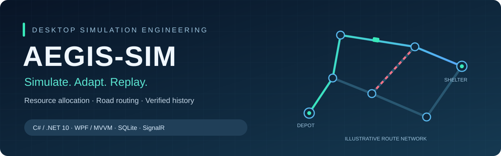
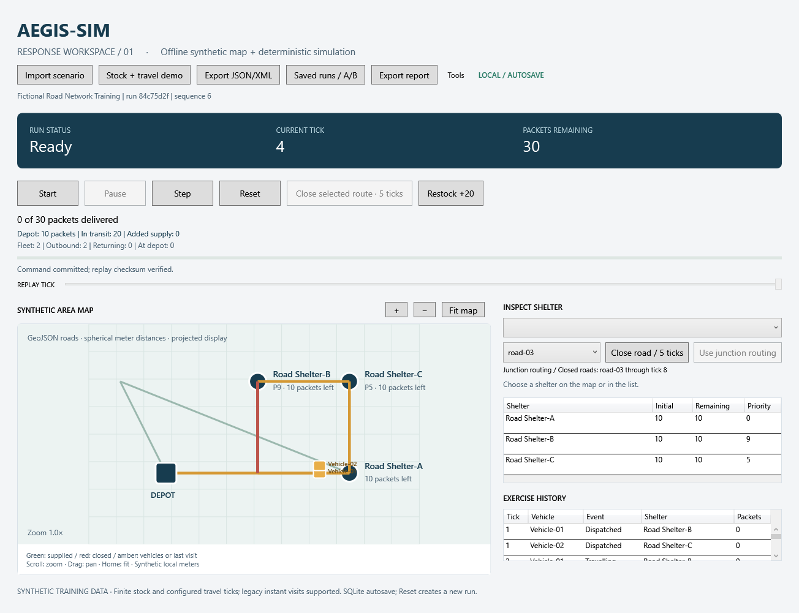
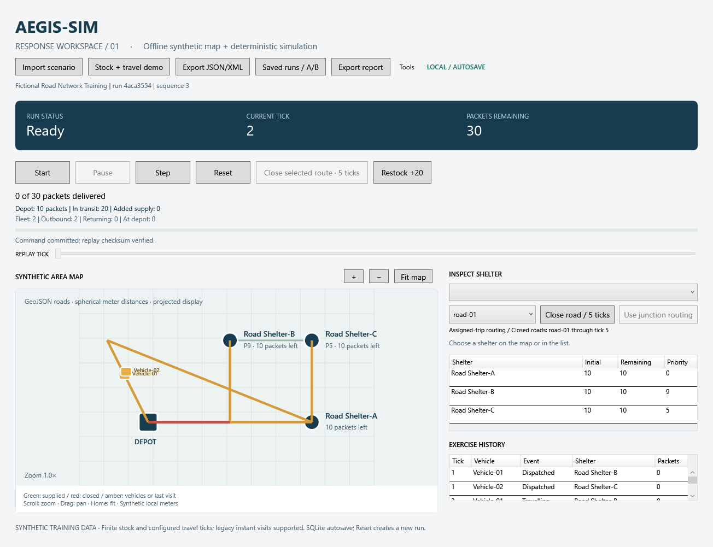
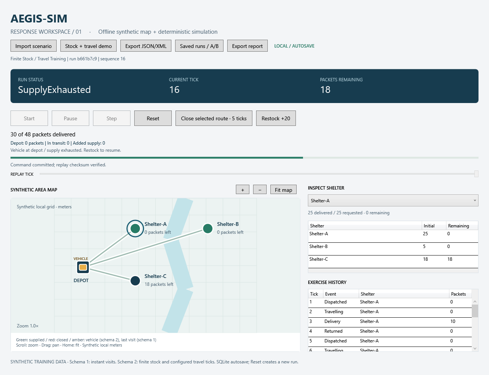
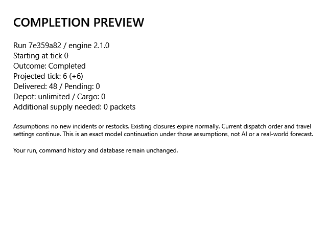
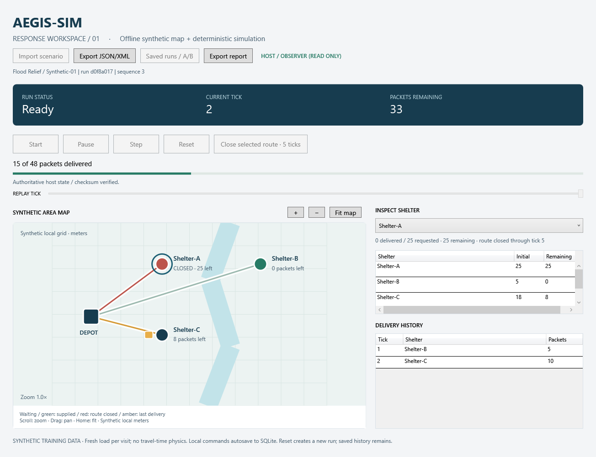
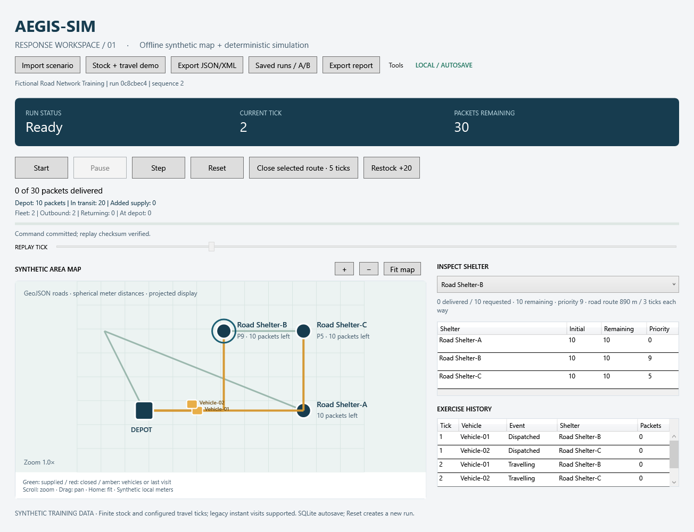
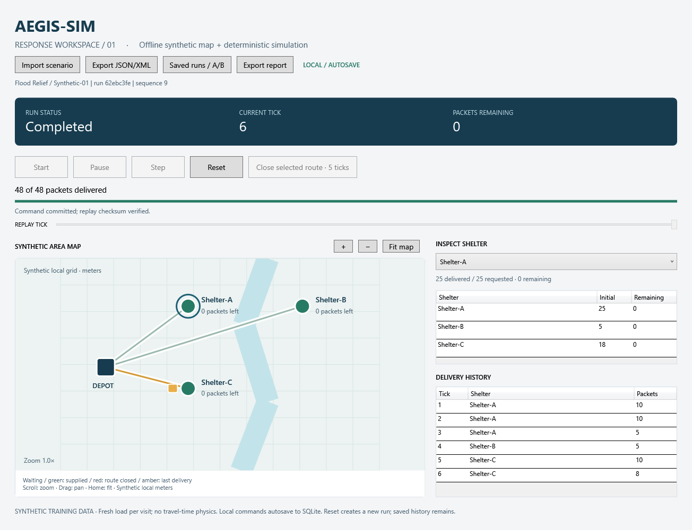
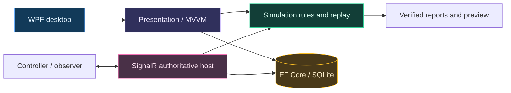
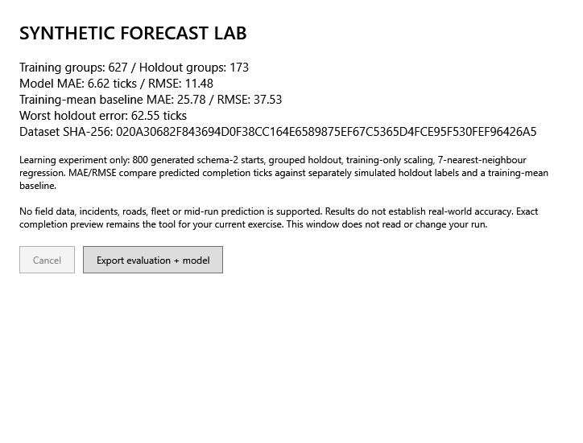

<p align="center">
  
</p>

<p align="center">
  <a href="https://github.com/DevMursLab/aegis-sim-desktop/actions/workflows/build.yml"></a>
  
  
  
  
  
</p>

<h1 align="center">AEGIS-SIM Desktop</h1>
<p align="center"><strong>A resource decision becomes a route. An incident changes the outcome. Every step can be replayed.</strong></p>
<p align="center">An independent C# desktop portfolio project for synthetic civilian response-training exercises.</p>
<p align="center">
  <a href="docs/REVIEWER-GUIDE.md"><strong>Five-minute reviewer guide</strong></a> &middot;
  <a href="#application-gallery">Application gallery</a> &middot;
  <a href="docs/demo-script.md">Demo walkthrough</a> &middot;
  <a href="https://github.com/DevMursLab/aegis-sim-desktop/releases/tag/v3.3.0">Windows download</a> &middot;
  <a href="docs/verification.md">Verification</a>
</p>

> **Version guide:** **desktop 3.3.0 / engine 3.2.0** includes shared road incidents, junction diversion, the synthetic forecast lab, cancellable report export and playback speed controls. The Windows x64 package includes its runtime. Older 3.0.1 downloads lack these additions.


## Engineering at a glance

| 🟦 Simulation | 🟩 Persistence | 🟧 Coordination | 🟪 Desktop experience |
|---|---|---|---|
| Deterministic tick engine | Transactional SQLite | Authoritative local host | WPF with MVVM |
| 1-8 vehicles, shared stock | Commands, events, checkpoints | Controller / observer roles | Map, inspector and history |
| Priority dispatch and rerouting | Replay and hash validation | Deduplication and reconnect | Background preview and replay |
| Explicit travel semantics | Legacy archive compatibility | Host restart recovery | Verified PDF / HTML / CSV |

### Concrete outcomes you can reproduce

| Exercise | Observed result | What it demonstrates |
|---|---|---|
| Baseline vs route closure | **6 vs 8 ticks**, 48 packets in both | Incidents change timing while supplies remain conserved |
| Shared-stock fleet | **3 vehicles: 8 ticks**; matching single vehicle: 24 | Concurrent dispatch with cargo reservations |
| Imported road exercise | **30 packets**, all vehicles returned at tick 14 | Road geometry drives distance and logical travel |
| Finite-stock recovery | Shortage at tick 16; restock completes at tick 24 | Explicit stock limits and replayable intervention |
| Source verification | **212 console checks**, zero build warnings/errors | Reproducible local audit, 28 October 2026 |

All figures describe supplied synthetic exercises. [Reproduce the demo](docs/demo-script.md) &middot; [Inspect evidence and boundaries](docs/verification.md).

## Application gallery

Actual application captures, with click-through full-size images.

<table>
<tr><td width="50%"><strong>🟦 Junction diversion</strong><br>Vehicles choose an open path at a reached node.<br><a href="docs/images/junction-routing.png"></a></td><td width="50%"><strong>🟥 Shared road incident</strong><br>Closed roads and alternate dispatch paths.<br><a href="docs/images/dynamic-roads.png"></a></td></tr>
<tr><td><strong>🟩 Multi-vehicle logistics</strong><br>Shared inventory, reserved cargo and movement.<br><a href="docs/images/fleet-transit.png"></a></td><td><strong>🟧 Priority decisions</strong><br>Scarce supplies go to eligible higher-priority demand.<br><a href="docs/images/priority-demo.png"></a></td></tr>
<tr><td><strong>🟪 Scenario editor</strong><br>Validate a draft and create a separate run.<br><a href="docs/images/scenario-editor.png"></a></td><td><strong>🟨 Offline GIS inspection</strong><br>Inspect bounded GeoJSON layers and features.<br><a href="docs/images/geojson-viewer.png"></a></td></tr>
</table>

<details>
<summary><strong>More application captures: stock, shortage, preview, roads and observer</strong></summary>

| Stock in transit | Supply shortage |
|---|---|
|  |  |

| Completion preview | Controller / observer |
|---|---|
|  |  |




</details>

## Architecture you can inspect



Simulation and presentation are independent of WPF. Commands are validated against replay, committed to storage, then published to the screen and clients. [Architecture details](docs/architecture.md) &middot; [Code review entry points](docs/REVIEWER-GUIDE.md#3-inspect-engineering-decisions).

## Synthetic forecast lab

A separate learning experiment fits **7-nearest-neighbour regression** to 800 generated initial states. Feature groups are split into **627 training / 173 holdout** groups; scaling and the constant baseline use training rows only.

| Holdout metric | Model | Training-mean baseline |
|---|---:|---:|
| MAE, logical ticks | **6.62** | 25.78 |
| RMSE, logical ticks | **11.48** | 37.53 |

Worst holdout error is **62.55 ticks**. This bounded synthetic experiment supports schema-2 initial states only; it does not establish real-world forecast accuracy. Use exact completion preview for a known exercise. [Exported evaluation and model](docs/evidence/forecast-evaluation-2026-10-28.json) &middot; [Implementation](src/Aegis.Simulation/ForecastLab.cs).



## Interview and delivery readiness

[Bangla interview preparation](docs/INTERVIEW-PREP.bn.md) covers the core classes, OOP/MVVM, routing, persistence, replay and honest technical boundaries. [Project status](docs/PROJECT-STATUS.md) distinguishes delivered portfolio features from future work.

## Start reviewing

**Without an SDK:** [download the Windows 3.3.0 release](https://github.com/DevMursLab/aegis-sim-desktop/releases/tag/v3.3.0), extract it and run `Start-Seeded-Demo.cmd`.

**Latest source, Windows + .NET 10:**

```powershell
dotnet run --project src/Aegis.Desktop.Wpf
```

**Verify the source:**

```powershell
powershell -ExecutionPolicy Bypass -File .\scripts\verify.ps1 -SkipUi
```

Omit `-SkipUi` on an interactive Windows desktop to include WPF interaction and reconnect checks. The 212-check badge records the local console audit; CI status is shown separately above.

---

<details>
<summary><strong>Full feature guide, exercises, setup, packaging and scope</strong></summary>

## A reviewable three-minute demo

1. Open the desktop app and select Shelter-A.
2. Close its route for five logical ticks and start the run.
3. Watch the map, inspector, event table and metrics change together.
4. Reopen a saved run after closing the app; seek its read-only replay timeline.
5. Compare baseline and incident runs, then export verified PDF/HTML/CSV.
6. Start a controller and observer; interrupt/restart the host and watch automatic state recovery.

The supplied seed tool produces the same comparison every time: **baseline 6 ticks / closure run 8 ticks / 48 packets delivered in both**. These are synthetic-model observations, not real-world performance claims. [Detailed demo script](docs/demo-script.md).

## Implemented

| Area | Working behavior |
|---|---|
| Desktop | Start, Pause, Resume, Step, Reset; command enablement and error feedback |
| Map | Offline local-meter vector view, selection, inspector, pan/zoom, keyboard alternatives |
| Offline GIS viewer | Bounded WGS84 GeoJSON import, Point/LineString/simple Polygon, feature selection, layer toggles and pan/zoom; view-only |
| Planning | Background deterministic completion preview, shortage explanation and cancellation; no history mutation |
| Diagnostics | Verified run/runtime snapshot export without credentials or paths; reproducible engine/replay profiling |
| Scenarios | Bounded/versioned JSON and XML import/export; coordinates, unique names and quantities validated; XML DTD/external resolver disabled |
| Logistics | Finite depot stock, cargo reservation, outbound/return ticks, shortage and replayable restock; vehicle position follows state |
| Incidents | Selected shelter route closed for five ticks; availability, ordering and completion metrics change |
| Persistence | Transactional EF Core SQLite runs, unique commands, typed tick events and checksummed checkpoints |
| Replay | Durable command replay, state-hash validation, read-only timeline; original history remains immutable |
| Comparison | Compatible-run A/B ticks, deliveries, mean service tick, active-tick percentage and waiting ticks |
| Reports | Actual PDF, UTF-8 HTML and CSV generated from verified replay; HTML/CSV escaping |
| Multiplayer | Local authoritative host, separate controller/observer tokens, version checks, deduplication, full-snapshot resync and automatic reconnect |
| Packaging | Self-contained Windows x64 ZIP, seeded demonstrations, per-user installer and source verification scripts |
| Learning | Bangla lessons from variables through persistence, replay, networking and packaging |

## Run from source

Requirements: **Windows x64 and the .NET 10 SDK**. Dependencies restore from NuGet; pinned versions and lock files are committed. No paid API, cloud account, external map tiles or manually configured database is required.

```powershell
powershell -ExecutionPolicy Bypass -File .\scripts\run-lesson.ps1 -Lesson 05
```

Or `dotnet run --project src/Aegis.Desktop.Wpf`. On first launch a local run is created. Later launches open the most recent saved run as read-only replay; **Reset** starts a fresh run with a new ID.

Local data: `%LOCALAPPDATA%\AEGIS-SIM\local\runs.db`. Import sample files from `assets/scenarios/`. Select **Saved runs / A/B** to replay one run or Ctrl+select two compatible runs to compare. Export report saves the **full selected run**, even when the replay slider is at an earlier tick.

Seed a separate review folder:

```powershell
dotnet run --project src/Aegis.Tools -- --seed .\artifacts\review-demo
dotnet run --project src/Aegis.Desktop.Wpf -- --data-dir .\artifacts\review-demo
```

The lesson launcher also supports a user-local SDK at `%LOCALAPPDATA%\Microsoft\dotnet`.

## Stock and travel exercise

Select **Stock + travel demo** in the source-built desktop, or import `assets/scenarios/finite-stock-travel.json`. Dispatch reserves cargo; arrival delivers it; the vehicle returns before loading again. The sample starts with 30 packets, stops at tick 16 with 18 still needed, then **Restock +20** permits completion at tick 24 with 2 in stock. Closure pauses an outbound vehicle; return travel is unaffected. [Bangla lesson 10](docs/learning/10-stock-travel.bn.md).

Engine 3.2 reads original 2.0, 2.1, 2.4, 2.5, 3.0 and 3.1 histories without changing their old hashes. Older binaries cannot open new engine 3.2 histories. [Release notes and remaining work](docs/release-notes.md).


[Shortage screen at tick 16](docs/images/logistics-shortage.png).

## Responsive saved history

Saved-run listing, SQL verification, comparison and replay reconstruction run in the background. Timeline requests cancel superseded replay work; a reset or new scenario discards pending results. Corrupt history preserves the previously displayed run. Source builds also export reports in the background from a frozen full-run copy: reset, seeking or new commands cannot change an in-progress export. One report export runs at a time, and failures allow retry. Desktop 3.3.0 uses engine 3.2.0; old desktop 3.0.1 packages use engine 3.0.0. Live command persistence remains synchronous.

## Roads that drive the simulation

Select **Tools / Road network demo**, or import `assets/maps/road-exercise.geojson`. Positive road lengths feed deterministic Dijkstra shortest paths; travel ticks are `ceil(route meters / metersPerTick)` in each direction. Vehicles follow the saved road polyline. Two vehicles deliver 30 packets and finish all returns at **tick 14**; routes A/B are 890 m and C is 1335 m. Priority dispatch, replay, host/observer, preview and HTML provenance use the same compiled exercise.


The sample is fictional. Distances use a spherical model rounded up per road; this is no routing-service or real travel-time claim. The imported default paths are undirected; source builds can recompute paths for new dispatches after road incidents. Edit the source GeoJSON and import a new run; the generic scenario editor is disabled for road exercises. [Road format and Bangla lesson](docs/learning/16-road-network.bn.md).

## Junction routing while vehicles are travelling

Source builds use engine **3.2.0**. Open **Tools / Road network demo** and choose **Use junction routing** in the inspector while every vehicle is at the depot. Step three times to reach the first junction, select `road-03` and choose **Close road / 5 ticks**. The vehicle serving B chooses `road-02` and continues through the open network with its reserved cargo. Vehicle positions follow the actual oriented road geometry.

An entered road finishes even if it closes; the vehicle chooses a shortest open path at each reached node, outbound and returning. With no open path it waits at that node. Each tick traverses at most one road, advancing up to metersPerTick within that road; unused movement is discarded at the next node. Timing therefore rounds upward separately for every road. Return paths may differ from outbound paths. This mode changes logical travel semantics and is enabled by a persisted command; default mode and original 3.1 histories keep assigned-trip behavior. Reset starts a new run with the mode disabled. [Bangla exercise](docs/learning/20-junction-routing.bn.md).


## Shared road closures and dispatch rerouting

Assigned-trip routing remains available in source builds. Open **Tools / Road network demo**, select `road-01` in the road picker and choose **Close road / 5 ticks** before stepping. New dispatches choose shortest open paths through `road-99`; distance, travel duration and vehicle geometry follow the detour. Closed edges appear red. If no path is available, vehicles wait at the depot without reserving cargo. A closure of any road in an assigned trip pauses that trip in place, including its return; it resumes after the closure expires. Assigned trips do not reroute midway. The return follows the assigned outbound path.

Commands, chosen paths, expiry ticks, checksums, SQL checkpoints, preview, host/observer and report traces preserve the incident. Old engine 3.0 and earlier histories remain readable; create a new run to use road incidents. Included in the 3.3.0 download; older 3.0.1 downloads lack this feature. [Bangla exercise](docs/learning/19-dynamic-roads.bn.md).


## Priority dispatch

Select **Tools / Priority + limited stock demo** or import `assets/scenarios/priority-limited-stock.json`. Priority 0-9 applies to fleet scenarios only. Higher ranks go first among open routes with unreserved demand; ties keep source-list order. With 20 packets, C (rank 9) receives 18 and B (rank 5) receives 2; A (rank 0) waits. All vehicles return at tick 4 before supply exhaustion. Select a dispatch row for its decision trace. The editor exposes ranks; replay and per-vehicle CSV preserve reasons. [Bangla lesson 15](docs/learning/15-priority-dispatch.bn.md). Priority is static, not a live command or starvation-prevention guarantee.


## Fleet simulation

Select **Tools / Three-vehicle demo**, or import `assets/scenarios/three-vehicle-fleet.json`. Three capacity-10 vehicles share 48 packets and complete at tick 8 with outbound=2 and return=1. The matching one-vehicle model needs 24 ticks. All vehicles use stable IDs, cargo reservations prevent double allocation, and completion waits for every return. The editor accepts 1-8 vehicles. [Bangla lesson 14](docs/learning/14-multiple-vehicles.bn.md).

Fleet actions persist inside one aggregate event per tick, preserving the SQL event key. The map and event table show each vehicle. PDF/HTML use replayed metrics; fleet export adds a per-vehicle CSV. Outbound/return counts are vehicle-ticks, while active percentage still counts elapsed ticks with any delivery. Static priority dispatch is supported: highest eligible rank first, with source-list order resolving ties; cargo already assigned is never redirected.


## Scenario editor

Open **Tools / Scenario editor** to edit a separate local draft: capacity, shelter names/demand/positions, finite stock and travel settings. Validate, save JSON/XML or start a separate run with a new ID. Invalid input cannot create a run; existing saved history remains available. Shared multiplayer scenarios cannot be edited here. [Bangla lesson 13](docs/learning/13-scenario-editor.bn.md).

The **3.3.0 Windows ZIP includes the editor, fleet, priorities, road incidents, junction routing and forecast lab**. [Download the release](https://github.com/DevMursLab/aegis-sim-desktop/releases/tag/v3.3.0).


## Inspect and plan

Open **Tools → Offline GeoJSON layers** and load `assets/maps/synthetic-region.geojson`. Inspect features from the list or toggle points, lines and areas. This is a separate view: imported geography does not change the simulation map, routes or travel times. The accepted regional GeoJSON subset and projection limits are [documented here](docs/learning/11-geojson.bn.md).

**Tools → Completion preview** calculates a continuation on a separate copy, assuming no new incidents or restocks. From replay it starts at the selected tick. **Tools → Export diagnostics** saves full-run identity, verified hash, runtime and a process sample without credentials or database paths. For repeated timing measurements run `scripts/profile.ps1`.


[Completion preview screen](docs/images/completion-preview.png) · [Observed local timing sample and hardware](docs/evidence/performance-2026-10-25.json).

## Two desktop clients

```powershell
powershell -ExecutionPolicy Bypass -File .\scripts\start-multiplayer.ps1
```

For a fresh logistics room, add `-DataDirectory .\artifacts\logistics-host -Scenario .\assets\scenarios\finite-stock-travel.json`. Existing saved room state takes precedence over the scenario option.

This starts a hidden local host plus controller and observer windows. **Only the host advances a network run.** Controller Reset starts a new shared run; previous runs remain in the host database. The script prints the host PID so it can be stopped after the demo.

The demo is **loopback-only**. Credentials live in `%LOCALAPPDATA%\AEGIS-SIM\host\session-secrets.json`; do not commit or share them. Roles are checked by the server, not just disabled in the UI. This is not an internet-deployment authentication system.

## Verify and package

```powershell
powershell -ExecutionPolicy Bypass -File .\scripts\verify.ps1
powershell -ExecutionPolicy Bypass -File .\scripts\package.ps1 -OutputDirectory .\artifacts\AEGIS-SIM-3.3.0-win-x64
python .\scripts\verify-package.py .\artifacts\AEGIS-SIM-3.3.0-win-x64.zip
```

Verification performs a locked dependency restore, full Release build with warnings treated as errors, **212 executable console checks**, all earlier console lessons, real WPF interaction checks, and a two-window host-restart/reconnect check. Checks are console executables, not an xUnit/`dotnet test` suite.

[GitHub Actions](https://github.com/DevMursLab/aegis-sim-desktop/actions/workflows/build.yml) runs the same Release build and console/integration checks on Windows with `-SkipUi`. Interactive WPF checks run locally. [Evidence and limits](docs/verification.md).

The package includes its runtime. Extract it, then use **Start-Local.cmd**, **Start-Seeded-Demo.cmd**, or **Start-Multiplayer.cmd**. No SDK is required. Optional `Install.ps1` copies the app into the current user's Programs folder and creates a desktop shortcut. No administrator rights are required.

## Architecture and learning

```text
WPF View → Presentation / commands → Simulation / rules and replay
                  ↓                          ↑
        SQLite persistence port     SignalR authoritative host
```

Simulation and presentation do not depend on WPF. A candidate command is replayed and validated, committed to SQL, then published to the screen/clients. [Architecture](docs/architecture.md), [demo script](docs/demo-script.md), [third-party notices](THIRD-PARTY-NOTICES.md).

[বাংলা শেখার শুরু](docs/learning/START-HERE.bn.md) → [01](docs/learning/01-supply-ticks.bn.md) → [02](docs/learning/02-shelter-objects.bn.md) → [03](docs/learning/03-tick-engine.bn.md) → [04](docs/learning/04-wpf-mvvm.bn.md) → [05](docs/learning/05-offline-map.bn.md) → [06](docs/learning/06-sql-history.bn.md) → [07](docs/learning/07-replay.bn.md) → [08](docs/learning/08-multiplayer.bn.md) → [09](docs/learning/09-release.bn.md)। Code প্রস্তুত; নিজের অনুশীলন ও ব্যাখ্যা দিয়ে শেখা যাচাই করবে।

## Scope and limits

This is a **portfolio simulator**, using fictional civilian scenarios. It does not reproduce an institution's internal military software. All demand begins at tick zero. Schema 1 retains instant delivery with a fresh load per visit. Schema 2 uses one vehicle with finite depot stock and configured travel/return ticks; schema 3 adds a shared-stock fleet of 1-8 vehicles. Schema 4 derives both travel directions from a bounded, static, undirected road network. Shelter route closure pauses assigned outbound trips. Source builds additionally support shared road incidents and shortest-open-path routing for new dispatches; assigned trips wait in place.

Legacy scenarios use synthetic local coordinates. Road exercises import a regional WGS84 subset, compute spherical road lengths, and retain projected display paths in saved history. The separate GeoJSON inspector remains view-only. Field-validated AI forecasts, general GIS/projection import, cloud deployment, high-scale load testing, a signed installer and comprehensive accessibility/high-DPI audits are outside this release. Full snapshots and command replay favor a small, explainable demo over throughput. PDF uses ASCII labels; HTML/CSV preserve Unicode names. SQLite schema version 1 upgrades legacy databases transactionally after making a consistent backup; unsupported future versions are refused. This is a specific tested upgrade, not a general migration framework.


</details>
