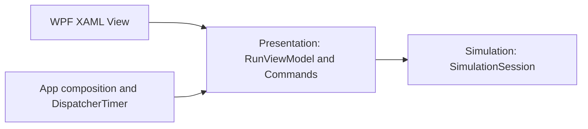

# Desktop preview architecture

The desktop preview is a small learning increment, not a completed GIS platform.

- `Aegis.Simulation` owns scenario input, readonly shelter state, delivery rules and lifecycle. It has no WPF, database, networking or clock dependency.
- `Aegis.Presentation` exposes observable screen state and commands. It uses standard .NET `ICommand` and `INotifyPropertyChanged`, without a WPF dependency.
- `Aegis.Desktop.Wpf` provides XAML layout, application composition and a one-second dispatcher timer. MainWindow code-behind contains only initialization.
- The timer advances only Running sessions. Manual steps are available in Ready/Paused. Completing a run disables mutation until reset.
- The session is single-threaded. The small demo runs on the dispatcher thread. Scaling to large simulations requires a separate scheduling strategy; no throughput claim is made.
- Source and published snapshots cannot change shelter data externally. Commands and the session validate transitions independently.
- A reset restores the original scenario and clears the current event feed. There is no persistent run identity or storage yet.
- Earlier lessons remain separate executable teaching examples. Production sources do not reference those lesson projects.

## Boundaries and limitations

The vehicle gets a fresh load each visit. Road travel, stock limits, maps, incident injection, SQL persistence, replay, multiplayer, authentication and forecasts remain unimplemented. Event history is in memory. Same ordered inputs reproduce the same delivery sequence; no random seed is needed by these rules.

## Verification

Run `scripts/verify.ps1` on Windows with the .NET 10 SDK. It builds all projects in Release with warnings treated as errors, executes 7 Lesson 03 checks and 13 desktop checks, runs all console lessons, and opens a real WPF window for smoke validation.

The smoke runner invokes real button automation peers, verifies rendered bindings and command enablement, waits for actual timer ticks, checks pause/resume/completion/reset and closes while running. Binding errors fail the run. It saves a rendered content image to the system temp directory. It is not a substitute for manual usability, keyboard, high-DPI or installation testing.

GitHub Actions builds the complete solution and runs the console checks/lessons on Windows. Interactive WPF validation is excluded from CI (`-SkipUi`). These are executable checks, not an xUnit or `dotnet test` suite.
