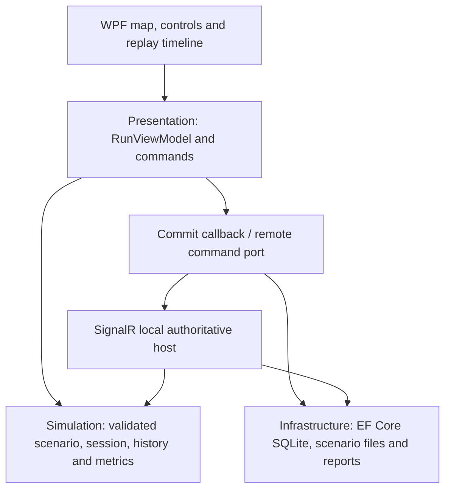

# AEGIS-SIM 2.5 source / engine 2.5 architecture

## Responsibilities

- **Simulation** owns immutable shelter state, bounded/versioned scenarios, lifecycle, deterministic delivery/closure rules, ordered recorded commands, checksums and metrics. No UI/database/network/clock dependency.
- **Presentation** exposes screen state, selected shelter, command enablement, map viewport calculations and replay seeking. A local command is reconstructed into a candidate, persisted through a callback, then shown. Storage failure does not publish the candidate and stops local advancement.
- **Infrastructure** reads validated JSON/XML, stores runs/commands/typed tick events/checkpoints in SQLite, and builds PDF/HTML/CSV from replay. Persistence uses one transaction and checks immutable history prefixes.
- **WPF** draws the offline map, handles visual gestures and file dialogs, composes services and schedules local ticks. MainWindow code-behind wires visual actions; delivery rules stay outside it.
- **SyncHost** serializes writes through one semaphore, owns network ticks, validates controller role and expected version, commits before broadcasting and returns full versioned snapshots. The desktop timer is disabled in network mode.
- **Tools** seeds a pair of reproducible comparison runs and sample reports.

## Lifecycle and replay

Ready → Running ↔ Paused → Completed. Manual Step is allowed in Ready/Paused; a completed run is immutable. Reset creates a **new run ID**, preserving old saved history. In network mode this is an authoritative controller operation.

Commands have stable IDs and contiguous per-run sequence numbers. Reusing an ID cannot apply an action twice. A closure blocks service through a configured future tick; other unblocked shelters may receive service, or a typed Waiting tick is emitted. The same scenario and ordered commands reproduce the same state checksum.

Every save persists the document, appended command rows, typed tick events and a final checkpoint. Load compares normalized SQL commands/events/checkpoints to reconstructed state. Timeline seek rebuilds the command prefix up to a tick; stored checkpoints are integrity evidence, not yet a replay acceleration cache. SHA-256 detects inconsistent/corrupted content, not malicious edits to every database field by a privileged attacker.

Schema 2 adds `SupplyExhausted`: pending demand with no depot stock or outbound cargo. Restock returns it to Paused. A trip has a dispatch tick, configured outbound ticks and configured return ticks. Completion waits for the final return. Closure can freeze outbound cargo/ETA; return travel ignores closure. Inventory obeys initial stock + restocked = depot stock + cargo + delivered.

## Data and protocol

Scenario schema 1: name, positive capacity and up to 64 shelters with unique names, bounded quantities and finite synthetic x/y. File size ≤256 KB; total demand ≤10000. XML disables DTD and external resolution. Runs cap ticks at 20000 and recorded commands at 25000.

Schema 2 adds mandatory finite `depotStock` (0..10000), `travelTicks` (1..20), `returnTicks` (0..20), and optional shelter travel overrides. Total supplied stock is capped at 10000. Restock is a durable command. Engine 2.1 accepts original engine 2.0/schema 1 histories and preserves their hash and normalized SQL serialization; only schema 2 hashes add vehicle/inventory fields.

SQLite tables: Runs, Commands (`RunId,Sequence`, unique `RunId,CommandId`), Events (`RunId,Tick`) and Snapshots (`RunId,Sequence`, indexed `RunId,Tick`). Bootstrap uses EnsureCreated and an explicit additive event-table upgrade for development databases. A general migration/backup strategy is future work.

One local exercise room is exposed at `/exercise`. Authenticated clients request Snapshot or Submit(runId,expectedVersion,command). The host broadcasts State(revision,run). Clients ignore older revisions, show a stale badge while reconnecting, and request a fresh snapshot after reconnection. The room revision is process-local; reconnect resets the client cursor before snapshot recovery. Host restart loads the latest saved run. Full snapshots intentionally favor a small training demo over throughput.

Separate random controller/observer tokens are stored in a local file. All non-health HTTP/hub routes require a token and reject non-loopback source addresses. Observer writes are denied server-side. This is a same-machine demonstration boundary, not multi-tenant/enterprise authentication.

## Map and metrics

Native WPF renders a 1200×800 fictional local-meter plane. Scenario files provide shelter positions. River/links are visual; the route-closure availability rule is explicit and separate from geometry. Schema 1 amber marks the last delivery. Schema 2 draws the vehicle between depot and destination using phase and remaining travel ticks; geometry does not determine travel duration. Map/table/inspector read the same session state; gestures cannot change results.

Completion = delivered / requested. Mean service tick = Σ(tick × packets) / delivered, with all demand available at tick zero. Active tick percentage = ticks with positive deliveries / elapsed ticks. Waiting ticks are explicit zero-delivery events. Zero denominators have documented values. A/B comparisons require identical scenario definitions; all numbers are recalculated from verified replay.

## Read-only review tools

Infrastructure's GeoJSON adapter validates a bounded regional WGS84 subset and returns immutable projected vector features. The separate WPF inspector reuses viewport gestures but does not map imported geography to simulation entities. Parsing succeeds before replacing the visible layer. No layer types enter the simulation domain or checksum.

CompletionPreview replays a document (or selected prefix) into a separate session, then steps it directly until completion, supply exhaustion or the 20000-tick cap. It does not repeatedly append/replay commands and does not save the continuation. WPF runs it in a background task with cancellation. New future interventions are explicitly excluded. Engine 2.5 adds static schema 3 priorities while retaining legacy hashes and normalized payloads when priorities are zero.

Diagnostics export verifies full selected history and emits bounded run/runtime facts without scenario names, paths or credentials. The separate profile tool measures engine-only ticks and verified replay with warmups and repeated samples; it does not characterize SQL, WPF or multiplayer throughput.

## Current scale

Small single-writer exercises; local simulation and persistence currently run on the UI dispatcher. Large scenarios can block the UI. No timing benchmark or production readiness is claimed. Distance/speed physics, general GIS import/projections, predictive AI, cloud hosting and signed deployment are outside this release. See verification and learning notes.

## Scenario draft editing

Presentation ScenarioDraft retains incomplete form input as strings, parses invariant numbers and builds a fresh validated ScenarioDefinition. Original and previously built shelter arrays are never edited. The WPF editor commits cell edits before validation, saves only validated JSON/XML, and starts a separate local run through the existing persist-before-publish path. Failed storage preserves the draft. Opening/closing a draft does not submit simulation commands; a running exercise may continue until the user starts a new run. Multiplayer scenario editing is disabled and rejected by the workspace.

## Shared-stock fleet

Schema 3 requires fleetSize 1-8 and the existing stock/travel settings. Every Step emits a single FleetTick containing exactly one ordered action per vehicle. Movement updates existing trips before dispatch. Only vehicles idle at tick start can dispatch; remaining demand is reduced by all outstanding outbound cargo when reserving loads. Stable IDs use invariant formatting. Completion/exhaustion require every vehicle at depot. Old schema 1/2 state hashes, event serialization and checkpoint shapes are unchanged. Schema 3 hashes/checkpoints include every vehicle.

WPF flattens tick actions into per-vehicle rows while persistence retains one event row per tick. Fleet map icon offsets separate co-located markers in screen space only. Metrics preserve elapsed delivery-tick percentages and packet-weighted service time; outbound/return sum vehicle actions. A per-vehicle CSV accompanies fleet reports. Static priority dispatch is described below; no distance routing or true multi-threaded mutation is introduced.

## Static priority and provenance

Schema 3 shelter priorities are bounded 0-9. Eligible targets must have open routes and unreserved demand; sort by descending priority then original list index. Existing outbound cargo never changes destination when another route becomes eligible. Priority does not age dynamically and may defer lower ranks while scarce stock is consumed.

ShelterState includes priority in hashes/checkpoints only when nonzero. Default-zero priority and default-null action reasons are omitted during JSON serialization, preserving original engine 2.4 fleet SQL events/checkpoints as well as 2.0/2.1 archives. Old engine documents with nonzero priority are rejected; new histories use engine 2.5. Dispatch reasons report the chosen rank, unreserved demand, loaded amount, resulting stock and tie rule; the engine creates these strings with invariant formatting. WPF and CSV display persisted/replayed provenance.
