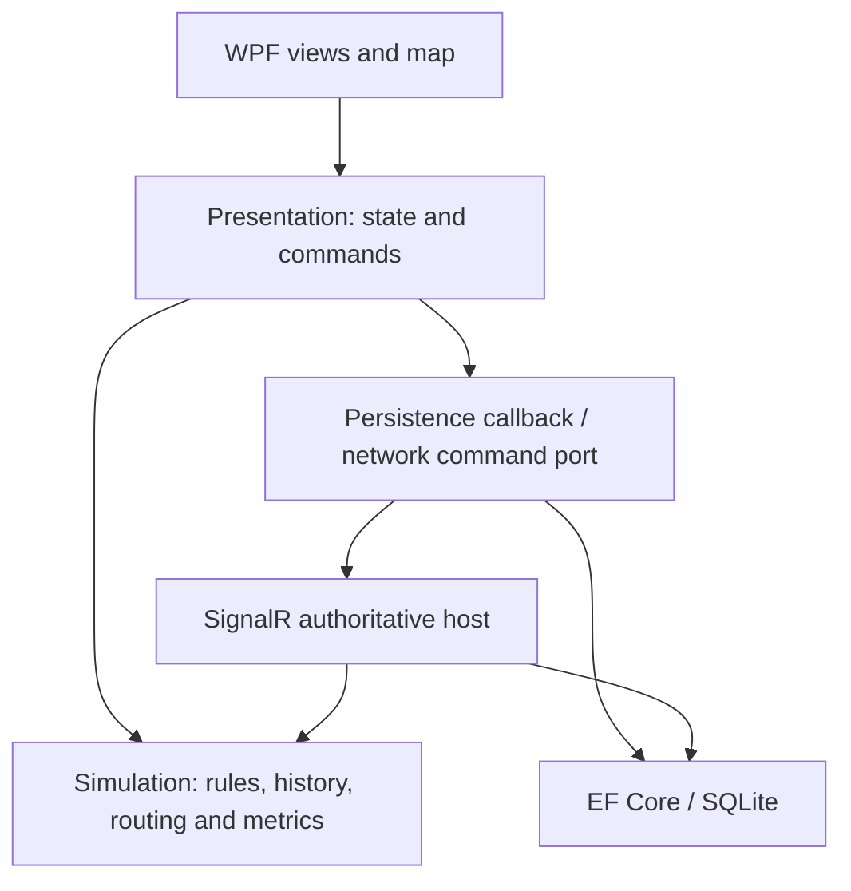

# Architecture

Desktop 3.3.1 / simulation engine 3.2.0. This document describes current behavior; historical changes are summarized in [release notes](release-notes.md).

## Responsibilities

| Project | Responsibility |
|---|---|
| Simulation | Scenarios, deterministic rules, reservations, routing, replay, hashes and metrics; no UI/SQL/network/clock dependency |
| Presentation | Bound state, command availability, selection, viewport, replay requests and persistence callbacks |
| Infrastructure | Validated scenario/GeoJSON input, SQLite storage/upgrades, diagnostics and verified reports |
| Desktop.Wpf | Views, drawing, dialogs, service composition and local playback timer |
| SyncHost | Serialized authoritative writes, roles/version checks, persistence and full-snapshot synchronization |
| Tools | Seeded histories/reports, engine/replay profiling and synthetic forecast evaluation |

## Commands, persistence and replay

A command is reconstructed into a candidate and validated by replay. The local persistence callback commits it before publication to the view. Save failure does not publish an advanced state. Host writes use the same commit-before-broadcast rule behind a semaphore.

Commands have stable IDs and contiguous per-run sequence numbers. Duplicate identity cannot apply an action twice. Lifecycle state gates commands; stock/travel scenarios can enter SupplyExhausted. Reset creates a new run ID and preserves earlier histories.

SQLite stores Runs, Commands, Events and Snapshots. Commands enforce per-run sequence and command-ID uniqueness; events have a run/tick key. Load compares stored commands, typed events and checkpoints with reconstructed state. Checkpoints currently verify integrity rather than accelerating replay. Checksums detect inconsistent content, not a privileged attacker rewriting every field consistently.

Database schema version 1 uses an explicit upgrade ledger. A legacy upgrade first makes a consistent SQLite backup; schema/event backfill is transactional. Failed upgrades roll back, and future/unrelated schemas are refused. This is a tested upgrade path, not a general migration framework.

## Simulation and routing

- Schema 1 retains immediate single-visit delivery for legacy histories.
- Schema 2 adds finite inventory, reserved cargo, outbound/return phases and restock. Initial stock + restocked = depot stock + cargo + delivered.
- Schema 3 adds 1-8 vehicles and static shelter priorities 0-9. Movement precedes dispatch; only vehicles idle at tick start can dispatch. Outstanding cargo is deducted from eligible demand. Stable vehicle/shelter ordering resolves ties.
- Schema 4 compiles bounded WGS84 road exercises. Positive integer road lengths feed deterministic Dijkstra paths; projected geometry drives display. Distance is calculated from original geographic coordinates.

Default assigned-trip routing chooses an open path at dispatch and retains it for return. Closing an edge on that assigned path pauses the trip until expiry. Unreachable demand is excluded before cargo reservation.

Explicit junction mode enables only with all vehicles at the depot. Entered roads finish even if closed. At reached nodes, shortest open paths are recalculated toward the original shelter or depot; no path means waiting without cargo loss. A tick traverses at most one edge and discards unused movement at a node. Return paths can differ. Journey geometry/progress participate in version-gated hashes.

Engine 3.2 reads supported original 2.0, 2.1, 2.4, 2.5, 3.0 and 3.1 fixtures without changing their hashes. Optional new fields are omitted for older branches. Older binaries cannot open engine 3.2 histories.

## Desktop threading

Database initialization, saved-history listing/load/verification, A/B calculation, replay reconstruction, preview and report generation run in background tasks. Superseded replay requests cancel cooperatively and cannot publish stale state. Reset/new scenarios invalidate pending work. SQL operations can finish after a dialog closes, but their results are discarded.

Live local commands, their persistence callback and final map/event publication remain synchronous on the UI dispatcher. Background history work does not establish large-history or low-latency guarantees. Playback speed changes pacing without changing logical history. Only the host advances network runs.

## Reports and analysis

Reports capture a frozen full-run document, verify it once and reuse reconstruction for metrics and PDF/HTML/CSV. Cancellation is checked during reconstruction/staging. Handled publication failures attempt to restore previous files; failed rollback retains originals in a reported recovery directory. Multi-file publication is not crash-atomic; concurrent exporters to the same destination are unsupported.

Preview continues a separate reconstructed session until completion, exhaustion or a tick cap, assuming no new interventions. Diagnostics omit scenario text, database paths and credentials. Profiling measures engine/replay only, excluding SQL/UI/network latency.

The forecast lab evaluates standardized inverse-distance 7-nearest-neighbour regression on generated schema-2 starts. Feature groups are split deterministically; scaling/baseline fitting use training rows only. It is not field-validated and does not support fleet/road/incident inference.

## Network and input boundaries

One local room uses `/exercise`. Non-health requests require a random controller/observer token and loopback source address. Observer writes are denied server-side. Commands include expected versions; snapshots carry revisions. Reconnect resets the client revision cursor and resynchronizes; host restart loads SQL history. This is not an internet authentication system.

Scenario JSON/XML and GeoJSON are bounded and validated before state replacement. XML DTD/external resolution is disabled. The separate GIS inspector is view-only. See [user guide](user-guide.md), [map format](../assets/maps/README.md) and [verification](verification.md).
