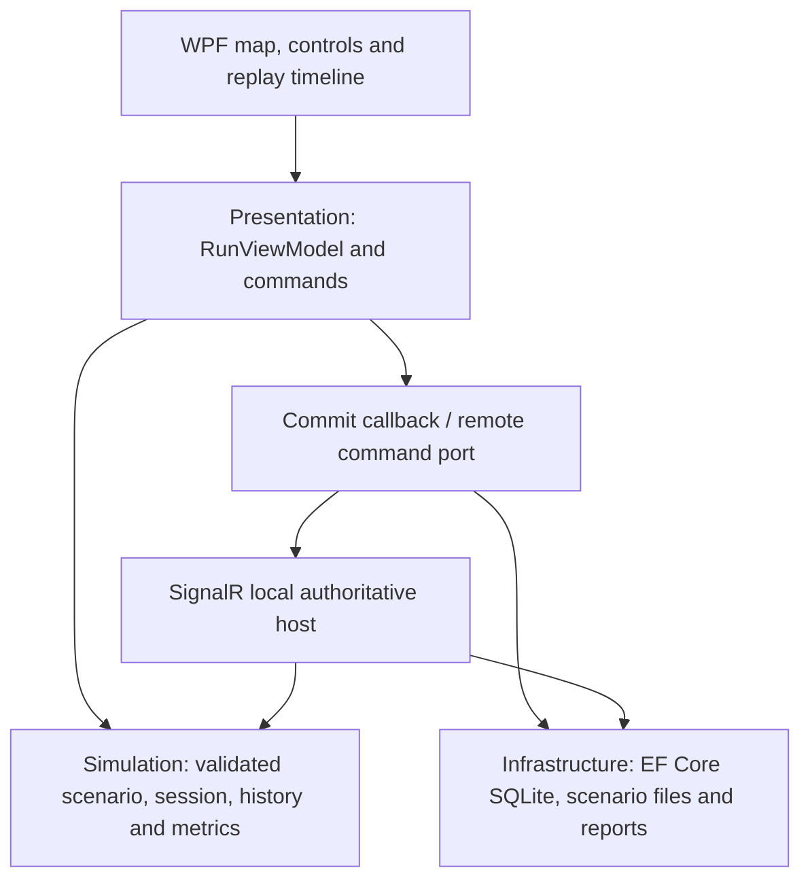

# AEGIS-SIM 2.1 architecture

## Responsibilities

- **Simulation** owns immutable shelter state, bounded/versioned scenarios, lifecycle, deterministic delivery/closure rules, ordered recorded commands, checksums and metrics. No UI/database/network/clock dependency.
- **Presentation** exposes screen state, selected shelter, command enablement, map viewport calculations and replay seeking. A local command is reconstructed into a candidate, persisted through a callback, then shown. Storage failure does not publish the candidate and stops local advancement.
- **Infrastructure** reads validated JSON/XML, stores runs/commands/typed tick events/checkpoints in SQLite, and builds PDF/HTML/CSV from replay. Persistence uses one transaction and checks immutable history prefixes.
- **WPF** draws the offline map, handles visual gestures and file dialogs, composes services and schedules local ticks. MainWindow code-behind wires visual actions; delivery rules stay outside it.
- **SyncHost** serializes writes through one semaphore, owns network ticks, validates controller role and expected version, commits before broadcasting and returns full versioned snapshots. The desktop timer is disabled in network mode.
- **Tools** seeds a pair of reproducible comparison runs and sample reports.

## Lifecycle and replay

Ready → Running ↔ Paused → Completed. Manual Step is allowed in Ready/Paused; a completed run is immutable. Reset creates a **new run ID**, preserving old saved history. In network mode this is an authoritative controller operation.

Commands have stable IDs and contiguous per-run sequence numbers. Reusing an ID cannot apply an action twice. A closure blocks service through a configured future tick; other unblocked shelters may receive service, or a typed Waiting tick is emitted. The same scenario and ordered commands reproduce the same state checksum.

Every save persists the document, appended command rows, typed tick events and a final checkpoint. Load compares normalized SQL commands/events/checkpoints to reconstructed state. Timeline seek rebuilds the command prefix up to a tick; stored checkpoints are integrity evidence, not yet a replay acceleration cache. SHA-256 detects inconsistent/corrupted content, not malicious edits to every database field by a privileged attacker.

Schema 2 adds `SupplyExhausted`: pending demand with no depot stock or outbound cargo. Restock returns it to Paused. A trip has a dispatch tick, configured outbound ticks and configured return ticks. Completion waits for the final return. Closure can freeze outbound cargo/ETA; return travel ignores closure. Inventory obeys initial stock + restocked = depot stock + cargo + delivered.

## Data and protocol

Scenario schema 1: name, positive capacity and up to 64 shelters with unique names, bounded quantities and finite synthetic x/y. File size ≤256 KB; total demand ≤10000. XML disables DTD and external resolution. Runs cap ticks at 20000 and recorded commands at 25000.

Schema 2 adds mandatory finite `depotStock` (0..10000), `travelTicks` (1..20), `returnTicks` (0..20), and optional shelter travel overrides. Total supplied stock is capped at 10000. Restock is a durable command. Engine 2.1 accepts original engine 2.0/schema 1 histories and preserves their hash and normalized SQL serialization; only schema 2 hashes add vehicle/inventory fields.

SQLite tables: Runs, Commands (`RunId,Sequence`, unique `RunId,CommandId`), Events (`RunId,Tick`) and Snapshots (`RunId,Sequence`, indexed `RunId,Tick`). Bootstrap uses EnsureCreated and an explicit additive event-table upgrade for development databases. A general migration/backup strategy is future work.

One local exercise room is exposed at `/exercise`. Authenticated clients request Snapshot or Submit(runId,expectedVersion,command). The host broadcasts State(revision,run). Clients ignore older revisions, show a stale badge while reconnecting, and request a fresh snapshot after reconnection. The room revision is process-local; reconnect resets the client cursor before snapshot recovery. Host restart loads the latest saved run. Full snapshots intentionally favor a small training demo over throughput.

Separate random controller/observer tokens are stored in a local file. All non-health HTTP/hub routes require a token and reject non-loopback source addresses. Observer writes are denied server-side. This is a same-machine demonstration boundary, not multi-tenant/enterprise authentication.

## Map and metrics

Native WPF renders a 1200×800 fictional local-meter plane. Scenario files provide shelter positions. River/links are visual; the route-closure availability rule is explicit and separate from geometry. Schema 1 amber marks the last delivery. Schema 2 draws the vehicle between depot and destination using phase and remaining travel ticks; geometry does not determine travel duration. Map/table/inspector read the same session state; gestures cannot change results.

Completion = delivered / requested. Mean service tick = Σ(tick × packets) / delivered, with all demand available at tick zero. Active tick percentage = ticks with positive deliveries / elapsed ticks. Waiting ticks are explicit zero-delivery events. Zero denominators have documented values. A/B comparisons require identical scenario definitions; all numbers are recalculated from verified replay.

## Limits

Small single-writer exercises; local simulation and persistence currently run on the UI dispatcher. Large scenarios can block the UI. No timing benchmark or production readiness is claimed. Distance/speed physics, general GIS import/projections, predictive AI, cloud hosting and signed deployment are outside this release. See verification and learning notes.
